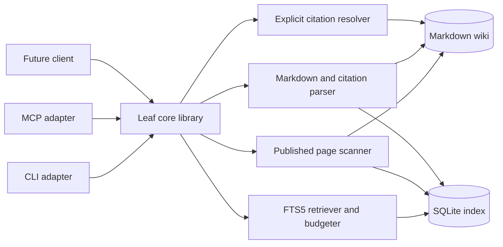
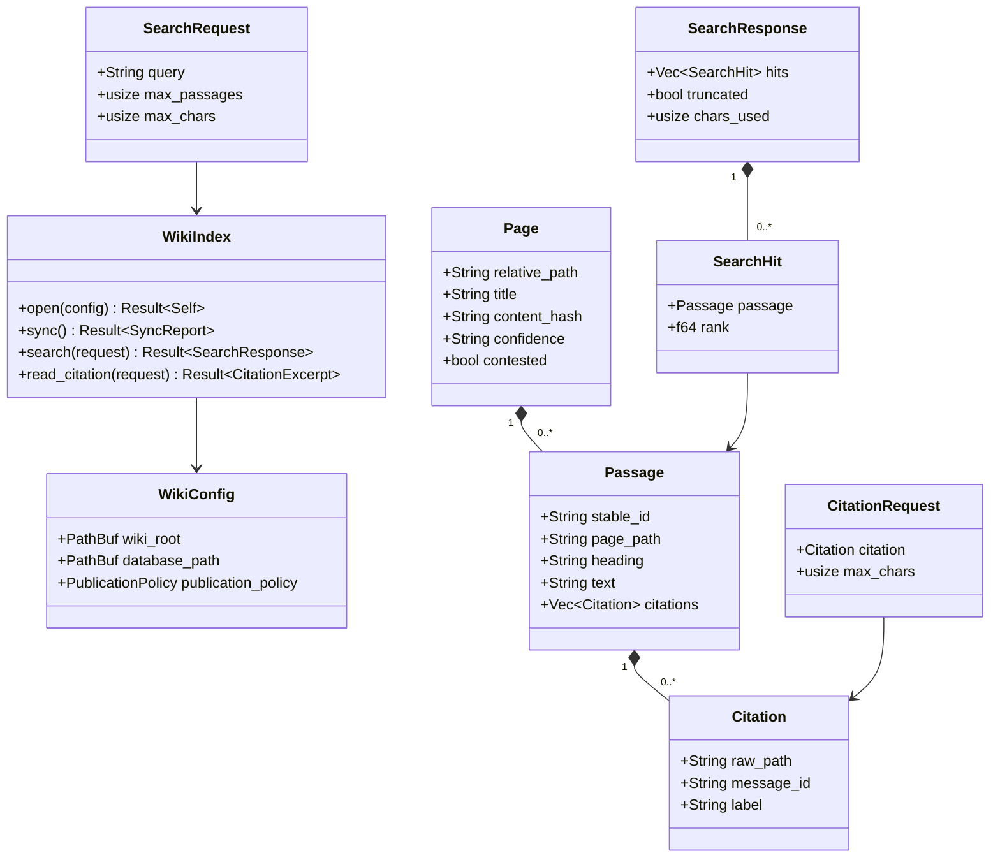
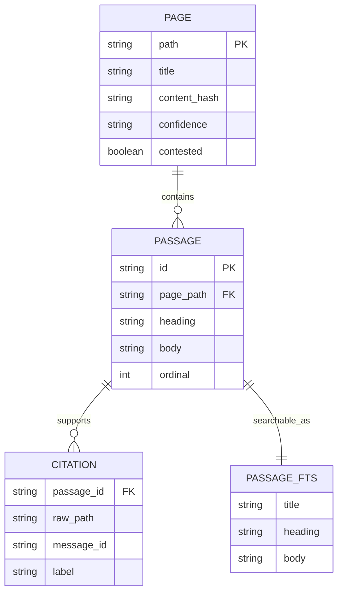
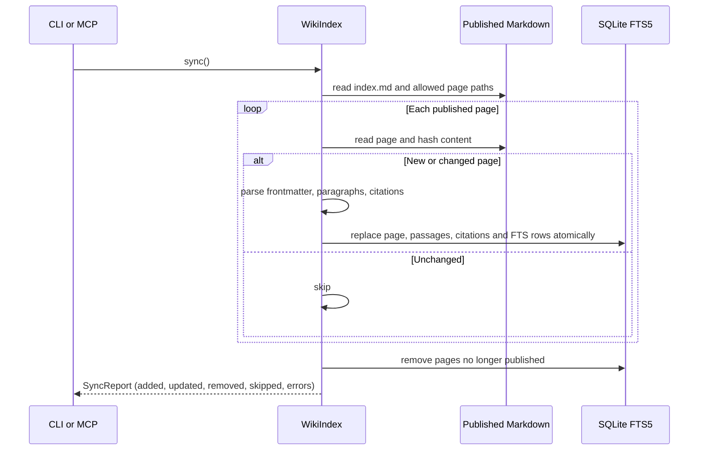
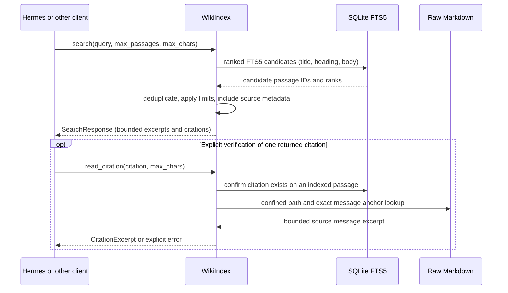

# Leaf core — design draft

> **Historical.** This is the original design draft. It is kept for its diagrams and rationale, but the current specifications are [SPEC.md](SPEC.md) (viewer) and [EDITOR-SPEC.md](EDITOR-SPEC.md) (editor), and the current state is in [ROADMAP.md](ROADMAP.md). Names here (for example a single `leaf-core` library) predate the split into `leaf-common`, `leaf-viewer` and `leaf-editor`.

Status at the time: proposed, not implemented. This document defines the portable Rust core; the CLI and MCP server are adapters, not dependencies of the core.

## Boundary and invariants

- The configured wiki root is the source of truth. The SQLite database is a rebuildable, local cache outside `raw/`.
- Only published Markdown under `entities/`, `concepts/`, `comparisons/`, and `queries/` is indexed by default. `_meta/`, `raw/`, and unlisted candidate evidence are excluded. A stricter published-only mode cross-checks `index.md` entries; this is the proposed default, so a draft in an allowed directory is not silently published.
- Split a page into paragraph-sized passages; preserve its title, heading, relative path, frontmatter quality signals, and `[[raw/...#^message-...]]` citations. Search results are excerpts, not entire pages.
- A query always has an output limit (`max_passages`, `max_chars`). An optional caller-provided token counter can enforce `max_tokens` later; the core must not claim tokenizer-exact bounds without one. Returned text **and** metadata count toward the output budget.
- No LLM, network, or transcript ingestion is needed to index or search. Source links are data, never executable instructions.
- Reading a raw citation is a separate API: accept only a citation discovered in an indexed page, canonicalize and confine the path to `wiki_root/raw/`, find the exact message anchor, and bound the returned excerpt. Do not read the whole transcript by default.

## Component diagram

## Domain model (Rust-facing)

`stable_id` should derive from page path plus a stable chunk locator, not SQLite row IDs. Exact Rust signatures and error types remain open until implementation. A result with insufficient budget returns no partial citation or misleading half-paragraph: it skips that passage and sets `truncated`.

## Persistent index

`PASSAGE_FTS` is an FTS5 virtual table, not a conventional SQL table. Implementation must keep its rows synchronized with `PASSAGE` in a transaction (via triggers or explicit writes), use bound SQL parameters, and convert free-text questions to safe FTS expressions rather than interpreting arbitrary query syntax. A schema version permits rebuilding the disposable index after upgrades.

## Incremental indexing

Malformed pages should be reported with paths rather than indexed as unsupported facts. On parse failure, remove that page's indexed rows and mark sync incomplete so stale content is not returned; on deletion or unpublication, remove its rows as well. Never modify Markdown or raw sources.

## Search and citation drill-down

## Open decisions before implementation

1. Should the published-page allowlist require `index.md` links (recommended), or should directory membership alone count as published? The schema says the index is complete; strict mode makes that contract operational.
2. How should passages with several citations be split if their full text plus citation metadata exceeds `max_chars`? Initial recommendation: skip the passage, report truncation, never drop its citations silently.
3. Should a caller-specific tokenizer be accepted as a Rust callback, or should adapters translate model token budgets into conservative character caps? Start with character limits; add tokenizer support once an actual model/client requires it.
4. Ranking: start with FTS5 BM25 and modest title/heading boosts, then evaluate against real questions before adding embeddings or graph expansion.
